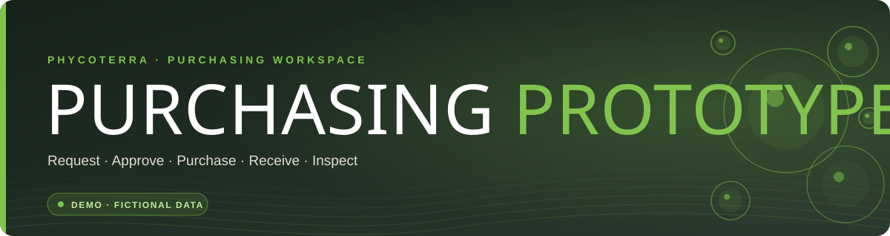
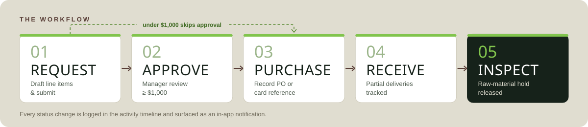

<div align="center">



<br>


**A standalone, browser-local prototype** for request submission, approval, purchasing,<br>
receiving, and human inspection.

[Run locally](#-run-locally) · [Walkthrough](#-demo-walkthrough) · [Business rules](#%EF%B8%8F-business-rules) · [Data](#-synthetic-data-and-source-context) · [Persistence](#-persistence-and-error-recovery) · [Branding](#-branding-and-assets) · [Power Apps](#-future-power-apps-integration)

</div>

<br>

> [!IMPORTANT]
> Built with React, TypeScript, and Vite. It is designed for later Power Apps Code Apps integration, but is **not deployed to Power Apps or connected to a tenant**.



<br>

## 🌱 Run locally

Verified with **Node.js 24** and **npm 11**. From this directory:

On Windows, you can instead double-click [`run-prototype.bat`](run-prototype.bat)
to install dependencies and start the app. It requires Node.js and npm on `PATH`;
close this app's development or preview servers before running it, because
dependency installation replaces `node_modules`.

```powershell
npm ci
npm run dev -- --host 127.0.0.1 --port 5173 --strictPort
```

Open [http://127.0.0.1:5173](http://127.0.0.1:5173). Stop the foreground server with `Ctrl+C`.

| Command | Purpose |
| --- | --- |
| `npm test` | Run the Vitest suite. |
| `npm run lint` | Run Oxlint. |
| `npm run typecheck` | Check TypeScript projects. |
| `npm run build` | Type-check and create the production build in `dist`. |
| `npm run preview -- --host 127.0.0.1 --port 4173 --strictPort` | Preview the production build locally. |

> [!NOTE]
> The build produces `dist`. Font assets and their license notices are included. The app makes no runtime requests to the marketing site, font CDNs, or business services.

### GitHub Pages

Every push to `main` builds and deploys the prototype to **https://lpreciado-nextant.github.io/PhycoterraPoC/** through [the Pages workflow](.github/workflows/deploy.yml). Production builds use the `/PhycoterraPoC/` base path (see [vite.config.ts](vite.config.ts)), so the local preview is served at `http://127.0.0.1:4173/PhycoterraPoC/`.

<br>

## 🧭 Demo walkthrough

The workspace uses short labels and minimal helper text. Approval thresholds, locked amounts, inspection requirements, and demo safety notices remain visible where needed; the optional tour provides additional guidance.

### Optional guided showcase

Choose **Guided walkthrough** in the top bar for an optional 22-step tour. It never starts automatically. Small popups explain the highlighted controls while the tour switches roles, queues, and request dialogs for you.

- Use **Next**, **Back**, or **Jump to a capability**. **Exit walkthrough**, **Escape**, or **Finish walkthrough** returns to the original workspace.
- The tour uses fresh **in-memory sample data**, not your saved records. It does not submit, approve, purchase, receive, inspect, reset, or write to browser storage. Background controls are blocked while the tour is active.
- Your original role, screen, filters, and scroll position are preserved. Reloading ends the tour and loads your saved data normally; no tour progress is persisted.
- It covers roles, overview counts, overdue queues, search/filters, drafts, line items, approval routing and rejection, PO/card purchases, partial receipts, manual inspection, completion, history, notifications, supplier summaries, activity, and persistence/reset.
- Popups support keyboard navigation and narrow screens, and can be restarted anytime. Recover any storage-loading error before starting the tour.

### Try the workflows yourself

| Step | Viewing as | Action |
| :---: | --- | --- |
| **1** | **Purchasing team – Janet** | Start here. The overview shows one pending approval, two requests ready to purchase, one overdue delivery, and one inspection hold. The **Awaiting your action** list shows only requests where Janet owns the next step; **Open Requests** lists everything still in progress. |
| **2** | **Purchasing team – Janet** | Select the overdue-delivery card to inspect **DEMO-004**, the fictional blank-label-stock order. Its **Request journey** shows every stage, the owning team, and the current stage. |
| **3** | **Requester team – Sarah Johnson** | Choose **New request**. Request 200 empty demonstration jugs at $6 each ($1,200). Save it as a draft first: switch teams and note that nobody else can see it. Then submit. |
| **4** | **Management – Jennifer Davis** | Open the request from Approvals and approve. A rejection instead requires a reason and is terminal in this demo. |
| **5** | **Purchasing team – Janet** | Open Purchasing and record a PO reference and expected arrival. No order is sent. |
| **6** | **Purchasing team – Janet** | Record part of the received quantity, then the balance. Overreceipt is blocked. |
| **7** | **Purchasing team – Janet** | Open **DEMO-007**, a generic raw-material placeholder on inspection hold. Record a manual pass with notes to release it and complete the request. |
| **8** | Anyone | Open **History** to see completed and rejected requests, and **Help** for what each team does and the request lifecycle. |
| **9** | Anyone | Choose **Reset demo data** and confirm to restore the 9 original scenarios. On narrow screens, **Reset demo** is in the page footer. |

Switch teams with the **Viewing as** control in the top bar. There are three teams with one person each: Requester team (Sarah Johnson), Management (Jennifer Davis), and Purchasing team (Janet). Drafts are visible only to the person who created them.

> [!TIP]
> For a quick no-approval path, submit a request below $1,000 or use DEMO-002. Record a credit-card **purchase reference**, never actual card details.

<br>

## ⚖️ Business rules

> [!CAUTION]
> **Illustrative policy only:** below $1,000 bypasses manager approval; $1,000 or more needs a manager. The company's actual approval matrix is not known.

| Area | Rule |
| --- | --- |
| 💵 **Totals** | USD totals are calculated in integer cents from line quantities and unit prices. |
| 🔢 **Limits** | Whole-number positive quantities; up to 50 lines and a $1,000,000 demo request total. Taxes, freight, discounts, FX, and price changes after submission are excluded. |
| 🔐 **Locking** | Submitted lines/amounts are locked. One supplier and one purchase per request. Drafts remain editable; rejected requests cannot be resubmitted. |
| 📅 **Dates** | Purchase date cannot precede approval or be in the future; expected arrival cannot precede purchase. Receipt dates cannot precede purchase or be in the future. |
| 📦 **Receiving** | Partial receiving tracks each line. An overdue shipment has an expected date before today and outstanding quantities. |
| 🔬 **Inspection** | Every raw-material receipt starts held. Only an explicit manual pass with notes releases it. Failed/unresolved inspections retain the hold. |
| ✅ **Completion** | Fully received material on inspection hold is not an overdue shipment. Completion requires all ordered quantities and no held material. |
| 🛡️ **Integrity** | Operations have idempotency tokens, and state transitions reject repeated purchases, duplicate receipt identifiers, unauthorized demo personas, and invalid quantities. |
| 📊 **Reporting** | All counters, supplier summaries, timelines, and notifications are derived from the same dataset. Order value is counted once per purchase, not once per receipt. |

<br>

## 🌿 Synthetic data and source context

The 9 scenarios, one per lifecycle stage, cover Seed Treatment and Soil Amendment demonstration supplies; field-sampling materials; QA equipment; packaging; and routine facility supplies.

**Public context:** [PhycoTerra home](https://phycoterra.com/) · [Soil Amendment](https://phycoterra.com/products/phycoterra/) · [Seed Treatment](https://phycoterra.com/products/phycoterra-seed-treatment/)

All transaction values, suppliers, destinations, and requests are fictional. Public product names provide context only. The company is not portrayed as purchasing its own products from invented suppliers. The generic DEMO-RM-A material are **not actual ingredients, formulations, or material specifications**.

Quotes, POs, packing slips, and COAs are reference-only metadata. There are no uploaded documents or fabricated safety certificates. Public SDS documents are not treated as supplier certificates of analysis. No real growers, customers, dealers, addresses, contact details, or testimonials are included.

<br>

## 🔒 Persistence and error recovery

- This app uses only the `phycoterra-purchasing-demo-v1` localStorage key.
- Data is seeded on first use and preserved across reloads. Relative seed dates are refreshed only on an explicit reset.
- Storage access, parsing, schema, and business-rule failures are displayed. Invalid data is not silently discarded; the recovery screen requires an explicit reset.
- Writes are validated and persisted **before** the UI reports success. A write failure keeps the last saved state and shows the error.
- Reset replaces this application's dataset only. It does not clear other applications' browser storage.
- Data is specific to the browser profile and origin (including port). It is not shared or synchronized between people or tabs. Use one active tab for edits.
- Persona switching is a demo device, not authorization. Local history is not a tamper-proof audit log.

> [!WARNING]
> Do not enter real confidential, financial, or material-quality data.

<br>

## 🎨 Branding and assets

The theme uses observed website colors, not an official brand manual:

| Swatch | Name | Hex |
| :---: | --- | --- |
|  | Lime | `#81C44D` |
|  | Forest | `#16221A` |
|  | Secondary forest | `#2A382E` |
|  | Sand | `#E0DDD0` |
|  | Earth | `#583D36` |
|  | White surfaces | `#FFFFFF` |

**Typography:** Work Sans for UI and Bebas Neue for short display headings.

Primary buttons use forest text on lime (~7.78:1 contrast). White on this lime would fail normal-text contrast. Statuses also have labels/icons, and keyboard focus is visible.

> [!IMPORTANT]
> The company name is currently ordinary text, **not an imitation or downloaded logo**. Replace it only with an approved company asset, retaining its native aspect ratio. Logo approval is pending. No proprietary photography, promotional artwork, tracking scripts, or marketing claims were copied.

Fonts are locally bundled through `@fontsource/work-sans` and `@fontsource/bebas-neue`. Both packages carry the SIL Open Font License 1.1. Their full copyright/license notices are retained in [Work Sans license](public/licenses/work-sans.txt) and [Bebas Neue license](public/licenses/bebas-neue.txt), which Vite copies into the build. CSS uses `font-display: swap` through Fontsource, with Arial/Impact sans-serif fallbacks. Lucide icons are provided by the `lucide-react` package.

The README artwork in [docs/assets](docs/assets/) embeds the same Bebas Neue and Work Sans fonts so it renders consistently on GitHub. It uses abstract shapes only, not a company logo.

<br>

## 🗂️ Implementation map

| Module | Responsibility |
| --- | --- |
| ⚖️ [Workflow domain](src/domain/workflow.ts) | Schemas, money/date helpers, state transitions, inspection rules, validation. |
| 🌱 [Seed data](src/data/seed.ts) | All 9 website-informed scenarios, constructed with the same workflow functions used by the UI. |
| 💾 [Storage](src/data/storage.ts) | Persistence, recovery, explicit error messages. |
| 📝 [Request form](src/features/RequestForm.tsx) | Draft creation/editing and submission. |
| 🔎 [Request detail](src/features/RequestDetail.tsx) | Approvals, purchasing, receipts, inspections, timeline. |
| 🧩 [App](src/App.tsx) | Navigation, team switching, queues/filters, overview, history, help, supplier summary, notifications. |
| 🎨 [Shared UI](src/components/ui.tsx) and [styles](src/index.css) | Dialogs, status presentation, brand tokens, responsive layout. |

The focused Vitest suite covers approval thresholds, role guards, locked amounts, duplicate actions, invalid dates/quantities, partial and mixed-material receiving, inspection holds, overdue calculation, seed integrity, and persistence failures.

<br>

## 🔌 Future Power Apps integration

Keep the domain and data module separate when adopting the Microsoft Code Apps template/SDK. Replace localStorage with a suitable connector-backed service rather than introducing SDK calls into presentation components.

Before integration:

1. Confirm tenant Code Apps support, licensing, environment access, DLP, connectors, and sharing permissions.
2. Agree on Dataverse/SharePoint or another operational store; QuickBooks remains the accounting authority.
3. Replace personas with authenticated identity and server-enforced permissions and invariants.
4. Provide trusted approval/inspection history, concurrency controls, approved document storage, and real notification flows.
5. Confirm the actual approval policy, delegates, pricing/tax rules, inspection authority, retention, and QuickBooks integration ownership.
6. Recheck the [Microsoft Code Apps quickstart](https://learn.microsoft.com/en-us/power-apps/developer/code-apps/how-to/create-an-app-from-scratch) before initializing or publishing. No tenant commands have been run.

> [!NOTE]
> Returns/RMA, outbound logistics, inventory, payments, automated certificate matching, barcodes, live messaging, multi-user synchronization, and production deployment are outside this prototype.

<br>

<div align="center">


<sub>All records are fictional. This is a demonstration, not a production purchasing system.</sub>

</div>